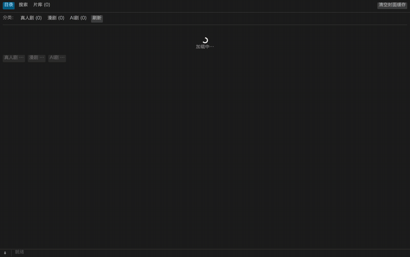
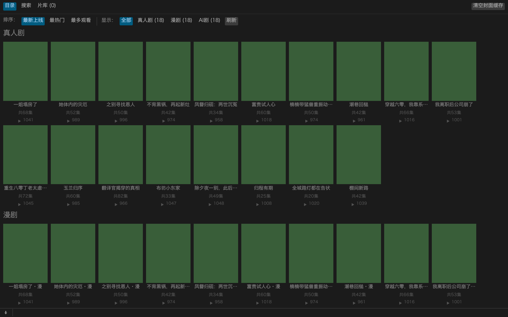
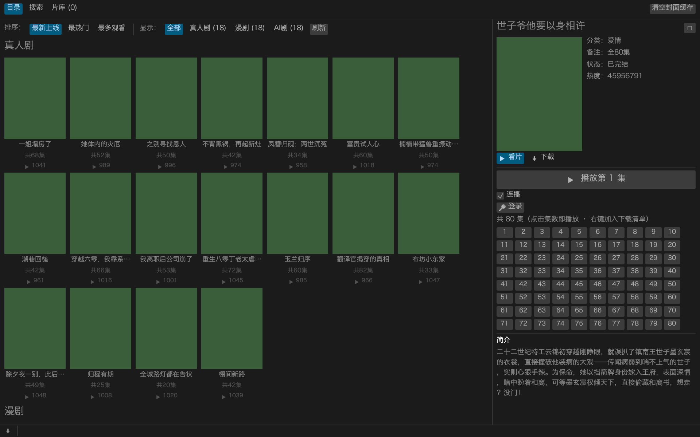
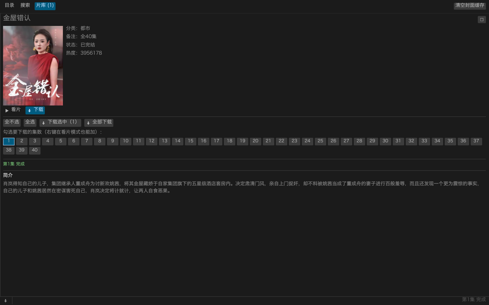

# guoapp（Rust 重写）

**在电脑上追红果短剧的桌面客户端**：封面卡片墙浏览 / 搜索 / 在线播放 / 离线下载，
含 **GUI（egui 原生窗口）与 CLI** 两套界面。参考
[zhoufuweigg/guoapp](https://github.com/zhoufuweigg/guoapp)
（Flutter + Go 原生核心，约 5.4 万行）的核心业务逻辑，用 Rust 从零重写：
release 下 CLI 约 **1.5 MB**、GUI 约 **4.0 MB**，单文件、无运行时依赖。

**三种看片方式**

1. **目录按热度排**：排序切换「最新上线 / 最热门 / 最多观看」——服务端排序
   加客户端稳定序，卡片直接显示观看数（94.7万 这种）；选择跨启动记忆
1. **在线播放**：不用下载，选「▶ 播放第1集」直接流式播放——自动解出 CENC
   加密金钥交给 mpv（`mpv --demuxer-lavf-o=decryption_key=…`），逐帧与
   本地解密文件一致（2026-10-12 实测）
2. **离线下载**：下载后自动解密成**普通 mp4**，任何播放器可放、可剪、可离线
3. **片库管理**：下载进度实时可见，完成后一键 ▶ 播放 / 打开目录



| 目录卡片墙 | 详情 · 选集 · 下载 | 片库 · 播放 |
| --- | --- | --- |
|  |  |  |

**反馈**：遇到问题（闪跳、下载失败、界面异常）或想要新功能？
[开个 Issue](https://github.com/ziyu4huang/guoapp/issues/new/choose)，
bug 请附 `guo --version`、平台与数据目录里的 `mpv-last.log` 尾部。

**🎬 视频演示**:[在电脑上追短剧——全功能演示](https://www.bilibili.com/video/BV1bCpZ6BEtb)(B站) ·
[YouTube](https://youtu.be/jkY7YnxR-b4)

> ⚠️ 免责声明：仅供学习研究。站源可用性、清晰度取决于源站及网络；本工具不解除
> 源站 VIP 或任何授权限制。请勿用于商业用途。如有侵权请联系删除。

## 原生 GUI（guo-gui）

```sh
cargo run --release --bin guo-gui     # 或直接运行 target/release/guo-gui
```

- **目录**：真人剧 / 漫剧 / AI剧 封面卡片墙，按分类续扫（「更多××」加载下一页）
- **搜索**：输入剧名回车，结果卡片墙（与 CLI 同一套合并排序逻辑）
- **详情面板**：点击卡片展开，封面、简介、点选集数（默认全选），
  「下载选中 / 全部下载 / 播放第1集」
- **下载管理**：双 worker 并发（与原版默认一致），实时进度条，失败原因内联显示
- **片库**：已下载剧目列表，每集 ▶ 按钮用系统播放器打开，「打开目录」直达文件夹
- 封面：CDN 返回 HEIC，macOS 上自动经系统 `sips` 转码（零额外依赖）；
  非 macOS 需站源返回 jpeg/webp 才有封面
- 在线播放：依赖 mpv（`brew install mpv`）；红果流是 CENC 加密的，工具自动把
  spade_a 解出的 AES 金钥经 `--demuxer-lavf-o=decryption_key` 交给 mpv 的
  mov 解复用器，逐帧 md5 与下载后本地播放完全一致（2026-10-12 实测）
- **播放会话（v0.3.0）**：单实例 mpv + JSON IPC——点下一集不再开新窗口，
  同一窗口 `loadfile` 无缝换集；窗口标题/OSC 显示《剧名》第N集；详情面板
  高亮正在播的集数、提供「⏭ 下一集」与「连播」开关（播完自动接下一集）；
  `--hwdec=auto`（macOS VideoToolbox）修复 HEVC 软解丢帧闪跳；播放器 stderr
  收进数据目录 `mpv-last.log`；播放器默认 mpv，想用 [IINA](https://iina.io/)
  （原生 macOS 界面/画中画）设环境变量 `GUO_PLAYER=iina` 显式开启；
  `GUO_MPV` 可指定任意 mpv 兼容播放器，`GUO_MPV_ARGS` 追加 mpv 参数
- **界面效率与体验（v0.3.1）**：后台消息即时上屏（封面/进度/播放事件不再等
  鼠标动才刷新）；封面抓取 4 并发队列（一页 18+ 张不再同时开线程）；目录/
  搜索/详情/片库列表渲染零逐帧克隆（之前每帧克隆全部剧集数据）
- **串流缓冲与连播（v0.3.2–v0.3.4）**：起播先缓冲 3 秒、预读 60s/上限 128MiB、
  CDN 断线自动重连、15s 网络超时兜底——网络抖动少卡顿；连播/下一集打在
  同一个播放器窗口上（idle 常驻会话，播完不关窗不重开），播完信号走 mpv
  标准的 end-file 事件；换集命令自动重试，缓冲期点击不报错
- **目录排序（v0.3.5）**：目录接口原生支持 `sort`（实测 play_cnt=按真实
  观看数、hot_score=平台热度榜、online_time=最新）——GUI 排序列+CLI
  `--sort`；同一排序两次请求顺序会漂（API 掺推荐），客户端按观看数稳定排序；
  网页回退通道不支持排序（保持原序）
- **无缝连播（v0.3.4）**：播放当前集时后台解析下一集并预载进播放器播放
  列表（`--prefetch-playlist` 提前缓冲）——播完瞬间 mpv 内部直接切换，
  无黑屏等待，像本地连播一样连续
- **播放器记忆（v0.3.3）**：窗口位置、大小（跨显示器稳定的 window-scale）、
  音量、静音、倍速、全屏/最大化跨启动恢复——拖好的窗口下次还在原地；
  macOS 读窗口坐标（CoreGraphics），其余平台恢复除位置外的全部设定；
  播放中/换集/关窗时自动捕获，改 GUO_MPV_ARGS 可随时覆盖
- 本地已下载文件用系统默认播放器
- 数据与 CLI 共用：`$GUOAPP_DATA` / `~/.local/share/guoapp`（macOS
  `~/Library/Application Support/guoapp`），下载状态两端互通

## 与原版的关系

| 原版（Go `native/core` + Flutter） | 本项目（Rust） |
| --- | --- |
| `provider_hongguo*.go` App API + X-Gorgon 签名 | `src/hgapp.rs` + `src/sign.rs` |
| 网页 `_ROUTER_DATA` 目录/详情/播放/搜索回退 | `src/hgweb.rs` |
| 备用播放中继 + v2 响应解密 + spade_a 密钥 | `src/backup.rs` |
| FFmpegKit / mpv 解 CENC | `src/cenc.rs`（自带渐进式 MP4 CENC-CTR 解密器） |
| HLS 捆绑下载（分片/密钥本地化改写） | `src/media.rs` |
| 追剧/下载记录 | `src/state.rs`（JSON 状态） |

未移植：Flutter UI、弹幕、画中画、画质增强、局域网同步、其他站源
（韩小圈/鬼片/青空/黄豆等）。要的就是精小：只保留红果一条完整闭环。

## 下载安装（预编译）

从 [GitHub Releases](https://github.com/ziyu4huang/guoapp/releases) 下载对应平台的压缩包
（tag push 后由 GitHub Actions 自动构建发布）：

| 压缩包 | 平台 | 内容 |
| --- | --- | --- |
| `guoapp-v*-macos-arm64.zip` | macOS（Apple Silicon） | `guo`（CLI）+ `Guo.app`（GUI） |
| `guoapp-v*-macos-x64.zip` | macOS（Intel） | 同上 |
| `guoapp-v*-windows-x64.zip` | Windows 10/11 x64 | `guo.exe` + `guo-gui.exe` |
| `guoapp-v*-linux-x64.tar.gz` | Linux x64（glibc） | `guo` + `guo-gui` |

- **macOS**：解压后把 `Guo.app` 拖进「应用程序」即可（未签名，首次打开右键 →
  打开；或 `xattr -cr Guo.app`）。CLI 想全局可用可 `cp guo /usr/local/bin/`。
- **Windows**：解压到任意目录直接运行 `guo-gui.exe`。在线播放需
  [mpv](https://mpv.io/)：安装后确保 `mpv` 在 PATH，或设环境变量
  `GUO_MPV` 指向 `mpv.exe` 完整路径。数据目录为
  `%USERPROFILE%\AppData\Local\guoapp`。
- **Linux**：解压后 `./guo-gui` 需 X11/Wayland 桌面环境；封面 HEIC 解码
  依赖 macOS `sips`，其他平台站源返回 jpeg/webp 时才有封面（当前已知限制）。
- **源码构建**：任何平台 `cargo build --release` 即可，无系统依赖。

## 构建

```sh
cargo build --release     # target/release/guo，约 1.5 MB
cargo test                # 7 项单元测试
```

依赖仅：ureq、serde/serde_json、md-5、sha2、hex、aes、cbc、base64、url，
GUI 另加 eframe（egui 0.31）、image（jpeg/png/webp）。

## 用法

```sh
guo catalog                          # 浏览目录（真人剧+漫剧+AI剧 各 1 页）
guo catalog --genre comic_series --pages 3
guo search 闪婚                      # 官网搜索 + 名称索引合并
guo suggest 重生                     # 搜索联想
guo detail hongguo:7632003395225668670
guo resolve <剧ID> 1                 # 打印播放地址 + CENC 密钥
guo play <剧ID> 1 --player mpv       # 在线播放（自动传 Referer + CENC 解密金钥）
guo download <剧ID> --eps 1-5,8      # 离线下载（缺省全部分集）
guo download <剧ID> --quality 720    # 指定画质
guo library                          # 本地已下载剧目
```

剧 ID 形如 `hongguo:7632003395225668670`（catalog/search/detail 输出第一列）。
所有命令支持 `--json` 输出结构化结果，方便脚本化。

### 数据目录

`$GUOAPP_DATA` 优先；默认 `~/.local/share/guoapp`（macOS：
`~/Library/Application Support/guoapp`）。内存放 `state.json`
（设备 ID + 分类游标）、`library.json`（下载索引）与 `library/<剧>/ep_NNN/`。

### 离线播放

- 直连 mp4：下载后自动解密 CENC（渐进式 MP4，AES-128-CTR，senc/saio/saiz，
  8/16 字节 IV 均支持），产出普通 `media.mp4`，任何播放器可放。
- HLS：分片与 AES-128 密钥全部本地化，`index.m3u8` 离线可播
  （`mpv ep_001/index.m3u8`）。
- 失败重跑同一命令即续传（.part + ETag/If-Range 校验，与原版一致）。

### 隐藏调试命令

```sh
guo fetch <URL> --referer <URL> --key <hex> --out <目录>   # 下载任意 mp4/m3u8
guo cenc-debug --file <mp4>                                # 打印轨道解析结果
```

## 取流回退链

1. App API（`api5-normal-sinfonlineb.fqnovel.com`，X-Gorgon/X-Khronos 签名）
2. 网页（`hongguoduanju.com`，`_ROUTER_DATA` JSON）
3. 备用中继（`djapi.999888456.xyz`，`v2.` 加密响应 + spade_a 内容密钥）

目录/详情/搜索同样具备 App → 网页 双层回退。

## 验证记录（2026-10-11）

- 签名：与原版 Go 算法的独立 Python 移植逐字节一致（单元测试固化）。
- 目录/搜索/联想/详情：真实 API 全通；网页回退路径验证通过。
- 取流：1080p 直连 mp4 + CENC 密钥。
- 下载 + 解密：`ffmpeg -v error` 全片（113s，HEVC 1080x1920 + HE-AACv2）
  零错误解码；逐样本字节与 `ffmpeg -decryption_key` 的参考输出一致。
- HLS 捆绑：本地 fixture（master→variant、AES-128 key、分片改写）端到端通过。
- 备用中继：实测返回 `v2.api_<hex>.<b64>`，与解析实现兼容。

## 源码结构

```
src/
├── lib.rs     库入口（CLI 与 GUI 共用）
├── main.rs    CLI 子命令（手写解析，无 clap）
├── bin/
│   └── guo-gui.rs   GUI 入口（薄壳，调 guo::gui::run）
├── gui/mod.rs 原生 GUI（egui 卡片墙 / 详情 / 下载管理 / 片库）
├── hgapp.rs   红果 App API（签名请求、目录游标、详情、取流、搜索）
├── hgweb.rs   网页回退（_ROUTER_DATA、搜索排序、合并）
├── backup.rs  备用播放中继（v2 响应解密、spade_a 密钥）
├── cenc.rs    渐进式 MP4 CENC-CTR 解密器（零依赖）
├── media.rs   取流回退链、HLS 捆绑下载、直连断点续传
├── sign.rs    X-Gorgon 签名与设备 ID
├── state.rs   状态与片库（JSON 持久化）
├── jsonx.rs   serde_json::Value 导航辅助
└── model.rs   Drama / Chapter / Media
```
